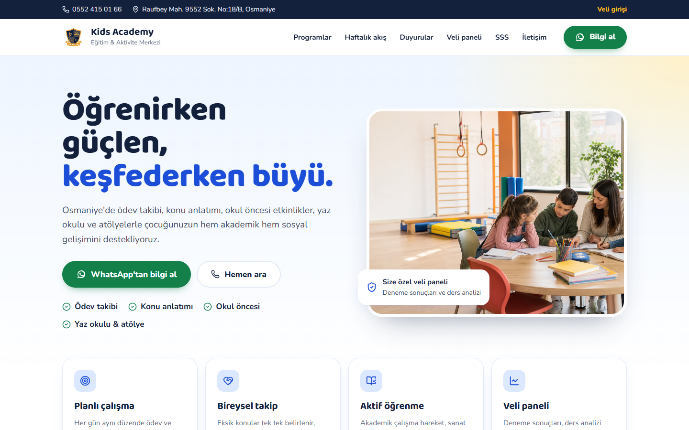

# Kids Academy

Bir eğitim kurumu için geliştirilmiş, yönetici tarafından yürütülen bir **admin paneli** ile velilerin çocuklarının deneme/sınav sonuçlarını takip edebildiği bir **veli portalı**ndan oluşan uygulama.

## Hangi sorunu çözüyor

**Sorun.** Küçük eğitim kurumlarında deneme sonuçları genellikle veliye tek tek mesajla gönderilir. Veli geçmiş sonuçlara ve gelişime bakamaz, kurum her denemede aynı bilgiyi sınıfın tamamı için yeniden yazar, duyurular sosyal medyada kaybolur.

**Çözüm.**
- Her veliye kendi şifresiyle girdiği bir panel: puan geçmişi, gelişim grafiği, ders ders doğru/yanlış/boş ve öğretmenin önerdiği çalışma konuları.
- Sınıfın tamamı için tek ekranda deneme girişi: soru sayısı bir kez girilir, boş ve net otomatik hesaplanır, toplamı tutmayan satır kaydedilmez.
- Kayıttan sonra her veli için hazır WhatsApp bildirim bağlantısı.
- Duyuru ve etkinlikler taslak olarak hazırlanıp önizlenir, istenince yayınlanır.

**Sonuç.** Uygulama gerçek bir eğitim kurumunda canlıda kullanılıyor.

### Teknik kararlar

- **Tarayıcı veritabanına hiç erişmez.** Bütün sorgular sunucuda; her tabloda RLS açık ve `anon` yetkileri kaldırılmış.
- **Kişiye özel yönetici hesapları.** Kurum sahibi ve personel rolleri; ortak şifre yalnızca kurtarma girişi. Pasifleştirilen hesap, oturum çerezinin süresini beklemeden dışarıda kalır.
- **Kaba kuvvet koruması veritabanında.** Serverless ortamda bellek paylaşılmadığı için hatalı girişler tabloda sayılır; kayıtlar 90 gün sonra kendiliğinden silinir.
- **Net ve puan hesapları saf fonksiyon.** LGS (3 yanlış), 4 yanlış ve cezasız kurallar birim testleriyle güvence altında.
- **KVKK.** Aydınlatma metni, saklama süreleri, yedekleme ve veri silme süreci belgelenmiş ([`docs/`](docs/)).

## Ekran görüntüleri

<!-- docs/screenshots/ klasörüne bu adlarla PNG ekleyin. -->
| Ana sayfa | Veli paneli (telefon) |
|---|---|
|  |  |
| **Toplu deneme girişi** | **Yönetici hesapları** |
|  |  |

## Özellikler

- **Admin paneli** — duyuru, etkinlik, sınav ve veli hesabı yönetimi (`/admin`)
- **Veli portalı** — her veliye özel bağlantı (`/veli/[slug]`) üzerinden sınav sonuçları, ders bazlı kırılım ve el çizimi tarzı SVG ilerleme grafiği
- **Yönetici hesapları** — kurum sahibi ve personel rolleriyle kişiye özel giriş; `ADMIN_PASSWORD` yalnızca kurtarma girişi
- **Veli erişimi** — her veliye kullanıcı adı + şifre ile bireysel giriş
- **KVKK aydınlatma metni** — `/kvkk`, giriş ekranlarından ve site altbilgisinden bağlantılı
- **Dosya yükleme** — duyuru/etkinlik görselleri Supabase Storage üzerinde tutulur
- **Rate limiting** — veritabanı destekli giriş denemesi sınırlama (serverless ortamda kalıcı çalışır)

## Teknoloji Yığını

| Katman | Teknoloji |
|---|---|
| Uygulama | Next.js 16 (App Router), React 19, TypeScript |
| Veri & Depolama | Supabase (Postgres + Storage) |
| Kimlik | Elle yazılmış HMAC-SHA256 imzalı oturum + scrypt şifre hash'leme (harici kütüphane kullanılmaz) |
| Test | Vitest |

Tüm veritabanı erişimi sunucu tarafında `service role` ile yapılır; RLS her tabloda açık olduğundan tarayıcı Supabase'e doğrudan erişemez.

## Kurulum

```bash
npm install
cp .env.example .env.local
```

`.env.local` içine doldurulacak değişkenler: `NEXT_PUBLIC_SUPABASE_URL`, `SUPABASE_SERVICE_ROLE_KEY`, `ADMIN_PASSWORD`, `SESSION_SECRET` (≥24 karakter), `NEXT_PUBLIC_SITE_URL`.

Yeni kurulumda `supabase/schema.sql` dosyasını Supabase SQL Editor'de çalıştırın. Var olan bir veritabanını güncellerken yalnızca `supabase/migrations/` altındaki henüz çalıştırılmamış dosyaları sırayla çalıştırın.

İlk girişte kullanıcı adını boş bırakıp `ADMIN_PASSWORD` ile girin, **Kullanıcılar** bölümünden kendinize *Kurum sahibi* hesabı açın; sonraki girişleri o hesapla yapın.

```bash
npm run dev     # geliştirme sunucusu (Turbopack)
```

## Komutlar

```bash
npm run dev      # geliştirme sunucusu
npm run build    # production derlemesi
npm run lint     # eslint .
npm test         # vitest run
npm run backup   # veritabanı ve fotoğrafları backups/ klasörüne indirir
```

## İşletim belgeleri

- [Yedekleme ve geri yükleme](docs/YEDEKLEME.md)
- [Sık karşılaşılan sorunlar](docs/SORUN-GIDERME.md)

## Canlı Demo

[kids-academy-phi.vercel.app](https://kids-academy-phi.vercel.app/)
